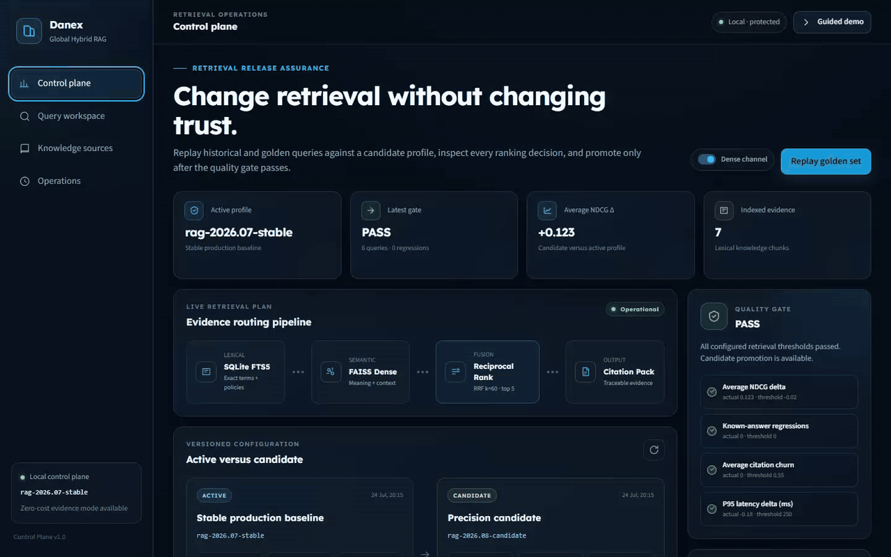
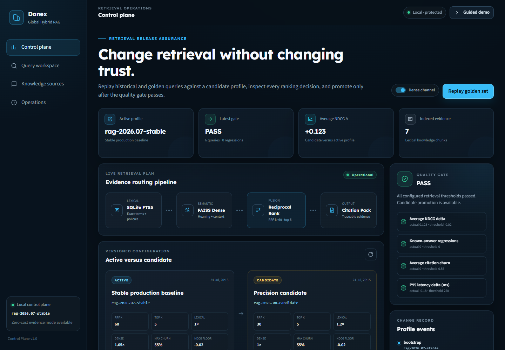
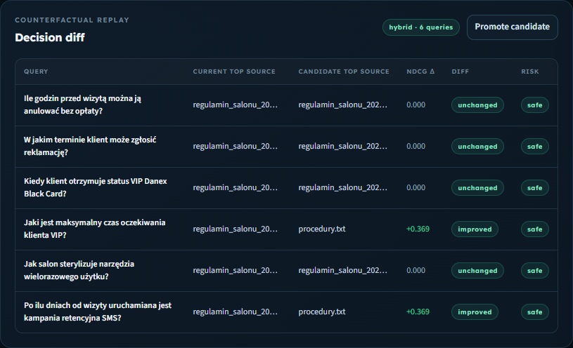
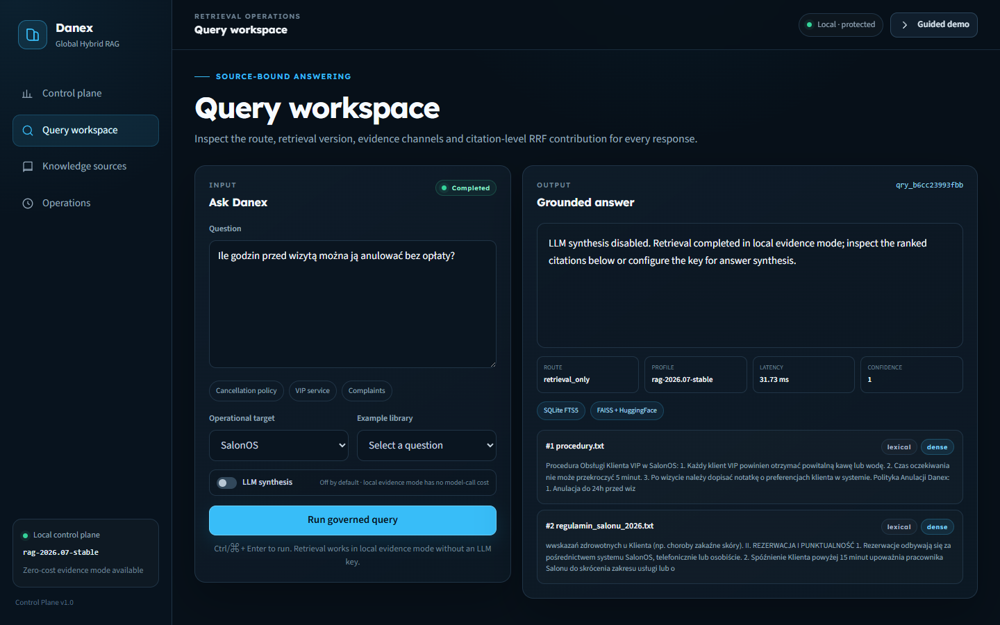
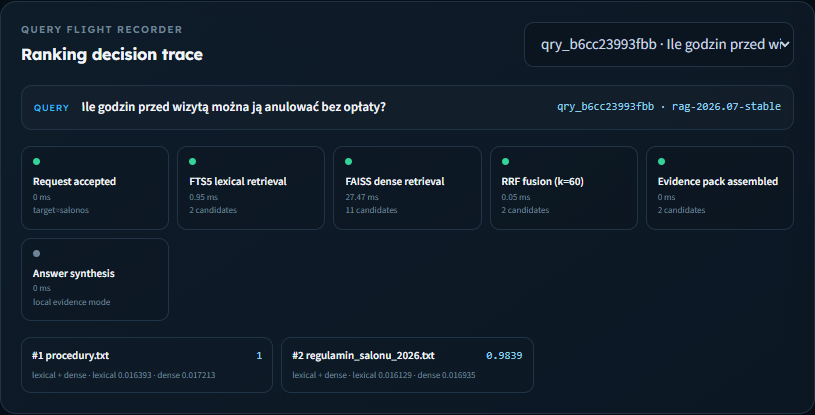

# Danex Global Hybrid RAG Service

> A governed retrieval service that combines SQLite FTS5, FAISS dense search, Reciprocal Rank Fusion, operational SQL, versioned retrieval profiles, regression replay, release gates, and query-level evidence traces.

[](https://fastapi.tiangolo.com/)
[](https://www.python.org/)
[](LICENSE)
[](https://github.com/danieloza/danex-rag-service/actions/workflows/ci.yml)

[Demo](#demo) · [Control Plane](#retrieval-control-plane) · [API](#enterprise-api-surface) · [Architecture](docs/ARCHITECTURE.md) · [Release Notes](CHANGELOG.md) · [License](LICENSE)

## Demo



The guided presentation moves from the active retrieval profile through the hybrid plan, candidate comparison, counterfactual replay, release gate, Query Workspace, and Flight Recorder. Model synthesis is disabled during the recorded path, so the evidence workflow does not consume an LLM API quota.



## Product Thesis

A useful RAG service must answer two different questions:

1. What evidence should be retrieved for this request?
2. Can a retrieval change be released without silently degrading known answers?

Danex addresses both. The runtime combines lexical and semantic evidence with structured operational data. The Retrieval Control Plane versions that behavior, replays historical and golden queries against candidate profiles, exposes ranking changes, and requires a passing quality gate before promotion.

## Retrieval Control Plane

The Control Plane is the primary differentiator:

- **true hybrid retrieval** — SQLite FTS5 and FAISS produce independent candidate rankings
- **Reciprocal Rank Fusion** — channel scores are fused through rank contributions instead of incompatible raw score scales
- **versioned profiles** — weights, rank constant, top-k and gate thresholds are stored as immutable candidate versions
- **counterfactual replay** — the active and candidate profiles run over the same historical and golden queries
- **decision diff** — every query shows current source, candidate source, NDCG delta, classification and risk
- **release gate** — promotion is blocked unless the latest candidate replay passes quality, regression, citation-churn and latency thresholds
- **controlled promotion and rollback** — state changes record the actor, previous profile and replay evidence
- **query Flight Recorder** — each request records lexical, dense, fusion, evidence and synthesis stages with durations and channel contributions

The committed six-query golden set produces two corrected top-source rankings in the captured local run, an average `NDCG Δ` of `+0.123`, and zero known-answer regressions.



## Query Evidence

Query Workspace operates in two explicit modes:

- **local evidence mode** — FTS5, FAISS, RRF, citations and traces run without an LLM call
- **synthesis mode** — an operator opts in to Gemini-backed answer generation and Text-to-SQL

If the model provider is unavailable or quota-limited, the API degrades to local evidence mode and preserves ranked citations. Provider error payloads are not returned to the UI.



Every response includes a `query_id`, active `retrieval_profile_version`, selected route, source channels, fused citations and correlation metadata.



## Architecture

```text
                     ┌──────────────────────────┐
Question ───────────►│ Active retrieval profile │
                     └─────────────┬────────────┘
                                   │
                    ┌──────────────┴──────────────┐
                    │                             │
            SQLite FTS5                    FAISS + local
          lexical retrieval                embeddings
                    │                             │
                    └──────────────┬──────────────┘
                                   ▼
                        Reciprocal Rank Fusion
                                   │
                         ranked citation pack
                                   │
                    ┌──────────────┴──────────────┐
                    │                             │
              evidence-only                  LLM synthesis
               zero-cost mode                  opt-in
```

Operational questions can additionally route through the existing controlled SQLite Text-to-SQL path. More detail is available in [docs/ARCHITECTURE.md](docs/ARCHITECTURE.md) and [docs/RETRIEVAL_CONTROL_PLANE.md](docs/RETRIEVAL_CONTROL_PLANE.md).

## Enterprise API Surface

Core query and ingestion:

- `POST /api/v1/ask`
- `POST /api/v1/query`
- `POST /api/v1/ingest/upload`
- `POST /api/v1/ingest/rebuild`
- `DELETE /api/v1/ingest/files/{filename}`
- `GET /api/v1/history/queries`
- `GET /api/v1/ingest/history`
- `GET /api/v1/evals/summary`

Retrieval governance:

- `GET /api/v1/retrieval/control-plane`
- `GET /api/v1/retrieval/profiles`
- `POST /api/v1/retrieval/profiles`
- `POST /api/v1/retrieval/replay`
- `GET /api/v1/retrieval/replays`
- `GET /api/v1/retrieval/replays/{replay_id}`
- `GET /api/v1/retrieval/traces`
- `GET /api/v1/retrieval/traces/{query_id}`
- `POST /api/v1/retrieval/profiles/{version}/promote`
- `POST /api/v1/retrieval/profiles/{version}/rollback`
- `POST /api/v1/retrieval/index/lexical/rebuild`

See [docs/API_EXAMPLES.md](docs/API_EXAMPLES.md) for representative contracts.

## MCP Server

[`mcp_server.py`](mcp_server.py) serves retrieval to agents over MCP (Streamable HTTP, official Python SDK). It is meant to run on loopback behind a gateway that decides who may call it, such as [mcp-security-gateway](https://github.com/danieloza/mcp-security-gateway).

```bash
python mcp_server.py   # http://127.0.0.1:8101/mcp; DANEX_MCP_HOST and DANEX_MCP_PORT override
```

| Tool | Returns |
| --- | --- |
| `search(question, limit)` | Up to `limit` passages (capped by the active profile's `top_k`) with source file, rank and score, plus a `query_id` |
| `get_trace(query_id)` | The recorded trace: stages, profile settings and the ranking detail behind each passage |

Both tools are read-only. The server answers from the lexical channel only: SQLite FTS5 ranked with the active profile's RRF settings. It imports `retrieval_control.py` and the MCP SDK, not LangChain, FAISS or a model provider, so dense retrieval, answer synthesis and Text-to-SQL stay in the HTTP API. Each trace records the dense stage as `skipped`.

## Demo Walkthrough

1. Open `Control plane`.
2. Inspect the active and candidate retrieval profiles.
3. Keep `Dense channel` enabled and select `Replay golden set`.
4. Review changed top sources, NDCG deltas and per-query risk.
5. Verify all quality-gate checks before enabling promotion.
6. Open `Query workspace`.
7. Leave `LLM synthesis` disabled and run a quick policy prompt.
8. Inspect lexical and dense citation badges plus source previews.
9. Return to `Control plane` and open the latest Flight Recorder trace.
10. Use `Guided demo` for the presentation overlay.

The demo path does not require paid infrastructure. The first dense request may take longer while the local embedding model warms up.

## Run Locally

```bash
git clone https://github.com/danieloza/danex-rag-service.git
cd danex-rag-service
python -m venv .venv
```

Windows PowerShell:

```powershell
.\.venv\Scripts\Activate.ps1
pip install -r requirements.txt
uvicorn main:app --host 127.0.0.1 --port 8002
```

macOS or Linux:

```bash
source .venv/bin/activate
pip install -r requirements.txt
uvicorn main:app --host 127.0.0.1 --port 8002
```

Open `http://127.0.0.1:8002/`.

### Environment

Copy `.env.example` to `.env`. `GOOGLE_API_KEY` is optional for local evidence mode and required only when LLM synthesis is enabled.

Optional overrides:

```text
SALONOS_DB_PATH=
DANEX_DB_PATH=
DANEX_CONTROL_PLANE_DB_PATH=.runtime-control-plane.sqlite3
DANEX_QUERY_HISTORY_PATH=.runtime-query-history.json
DANEX_ENABLE_LOCAL_EMBEDDINGS=1
```

## Build the Index

```bash
python ingest.py
```

The ingestion pipeline writes:

- FAISS dense index files under `faiss_index/`
- FTS5 lexical chunks into the local Control Plane SQLite store
- ingestion metadata and source-change history

MarkItDown supports PDF, DOCX, PPTX, XLSX, HTML, CSV and JSON conversion when the corresponding parser is available.

## Verification

```bash
python -m pytest -q
node --check static/app.js
```

CI runs the backend test suite on Python 3.11. The local browser acceptance path covers:

- 1440 px desktop presentation
- 375 px mobile navigation
- hybrid golden-set replay
- query execution in zero-cost evidence mode
- Flight Recorder rendering
- guided demo progression
- browser console errors

## Production Boundaries

This repository provides a production-shaped reference implementation, not a claim of completed production deployment.

- The default Control Plane store is local SQLite; a multi-replica deployment should use a transactional shared database.
- FAISS is a local index; global scale requires managed or partitioned vector infrastructure and an explicit data-residency model.
- Profile actors are request fields in this portfolio build; a company deployment should derive identity from IAM claims.
- Text-to-SQL requires schema restrictions, read-only credentials, query validation and database-specific resource limits.
- Retrieval traces may contain sensitive query or evidence data and require retention, access-control and redaction policies.
- The committed golden set is intentionally small and should be replaced with domain-owned relevance judgments before rollout.

## Documentation

- [Retrieval Control Plane](docs/RETRIEVAL_CONTROL_PLANE.md)
- [API examples](docs/API_EXAMPLES.md)
- [Architecture](docs/ARCHITECTURE.md)
- [Case study](docs/CASE_STUDY.md)
- [Release notes](CHANGELOG.md)

## License

Released under the [MIT License](LICENSE).
